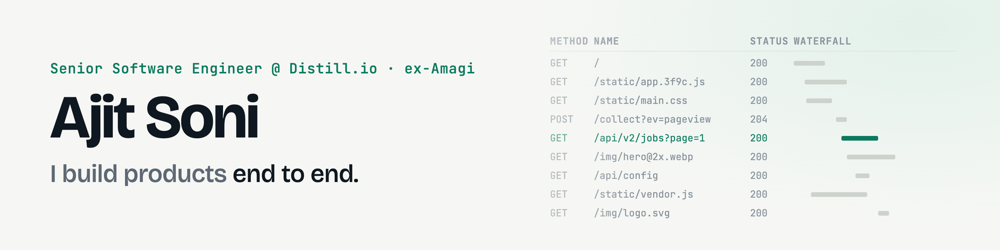

<a href="https://ajitsoni05.github.io/portfolio/">
  <picture>
    <source media="(prefers-color-scheme: dark)" srcset="assets/banner-dark.png">
    
  </picture>
</a>

Product engineer in Bengaluru with 4.5 years of shipping across backend and frontend. Senior Software Engineer at [Distill.io](https://distill.io), previously [Amagi](https://www.amagi.com).

At work I build archival pipelines and search engines. On my own I ship small, quiet tools to real users. Strongest in **Go** and **Node.js**, and I own the UI in **Svelte** and **TypeScript** too.

**Now:** search and web-page archival at Distill.io · shipping FocalReader · Labyrinth in public beta on iPhone, iPad and Apple Watch · rebuilding Spark in Scala to learn how it works.

## Shipped

| Product | What it is |
| --- | --- |
| **[FocalReader](https://focalreader.com)**  | A reading spotlight for people with ADHD and dyslexia, on [Chrome](https://chromewebstore.google.com/detail/focalreader-%E2%80%93-adhd-focus/ccmkhgbcbcjmhmpeomaljbnlifdhgbjg) and [Firefox](https://addons.mozilla.org/en-GB/firefox/addon/focalreader-adhd-focus-reader/). It dims the page around the paragraph you're on. Smart Window steps through a page from the keyboard, and Explain (AI) rewrites a dense paragraph in plain language. |
| **[FocalTabs](https://chromewebstore.google.com/detail/focaltabs/ogcpbfooclilidipalggkblcggicndik)** | Chrome extension for time-aware tab management. Tabs you stop using cool into a group, snooze themselves and land in a searchable archive. |
| **[Labyrinth: Steel & Wood](https://ajitsoni05.github.io/labyrinth/)**  | The wooden tilt-maze toy for iPhone, iPad and Apple Watch. Deterministic rolling physics at 1,200 Hz, an autopilot that checks every level I designed can be won, and music the game composes itself. 46 levels and a Daily Maze. [Join the beta](https://testflight.apple.com/join/ynHM7mc5). |

## Open source

| Project | What it is |
| --- | --- |
| [**mini-spark**](https://github.com/ajitsoni05/mini-spark) · Scala 3 | A Spark-style data engine: lazy RDDs, a DAG scheduler, shuffles with map-side combine, and lineage-based fault tolerance tested under injected failures. |
| [**mhtml-go**](https://github.com/ajitsoni05/mhtml-go) · Go | A faithful, lossless MHTML parser. Standard library only, lazy part decoding, golden and fuzz tests. |
| [**go-redis**](https://github.com/ajitsoni05/go-redis) · Go | A Redis-like in-memory server speaking RESP: SET, GET, DEL, ZADD, NX/XX writes, TTL expiry and concurrent clients. |
| [**TravelPlan**](https://github.com/ajitsoni05/TravelPlan) · JavaScript | Route planner across air and rail networks using Dijkstra's algorithm, with a Vis.js graph. [Live demo](https://ajitsoni05.github.io/TravelPlan/). |

## Toolbox

Go · TypeScript · JavaScript · Python · Ruby · C++ · Swift · Node.js · Svelte · browser extensions · PostgreSQL · SQLite · MySQL · MongoDB · Docker · Kubernetes · AWS · GCP

## Elsewhere

[Portfolio](https://ajitsoni05.github.io/portfolio/) · [LinkedIn](https://www.linkedin.com/in/ajitsoni05/) · [LeetCode](https://leetcode.com/u/ajitsoni/) (800+ solved) · ajitsoni000005@gmail.com
